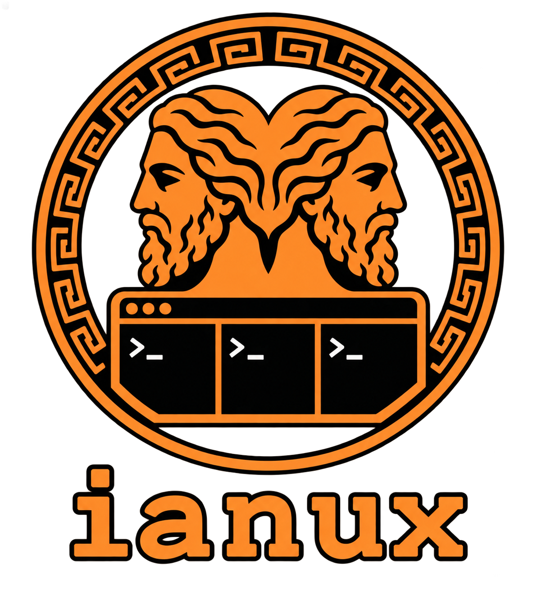

# Ianux Wiki



Ianux is a command-line wrapper for common [tmux](https://github.com/tmux/tmux) session workflows. It can create multi-window, multi-pane workspaces, launch commands in detached sessions, list and attach to sessions, close sessions or panes, and save or restore session layouts.

## Wiki pages

- [Installation and setup](Installation.md)
- [Command reference](Commands.md)
- [TOML session configurations](Configuration.md)
- [Architecture](Architecture.md)
- [Development and testing](Development.md)

## Quick start

Requirements: Python 3.11+, [uv](https://docs.astral.sh/uv/), and `tmux` available on `PATH`.

```bash
uv tool install .
ianux --help
ianux session -p 4
```

For a checkout-local environment, use `uv sync` and prefix commands with `uv run`.
In `session` mode, `-p`/`--window-panes` sets each window's pane count and
`-w`/`--window-name` sets its name; repeat either option for multiple windows.

## Commands

| Command | Alias | Use |
|---|---|---|
| `session` | `s` | Create a workspace and attach to it (the default command) |
| `list` | `ls` | List open sessions with numeric IDs |
| `attach` | `a` | Attach interactively or to a session/window/pane |
| `kill` | `k` | Kill a session, window, or pane |
| `load` | `l` | Create a workspace from TOML |
| `dump` | `d` | Save pane directories from a session as TOML |

Run `ianux <command> --help` for current options. The [command reference](Commands.md) describes the main workflows and addressing rules.

To start commands without attaching, use `ianux session -d`. Repeat `-p`/`-w`
to create multiple windows and `-c` to assign a command to each pane in order.
For example:

```bash
ianux session -d -p 2 -w app -p 1 -w logs \
  -c 'npm run dev' -c 'npm test' -c 'tail -f app.log'
```

This starts three commands in two windows and leaves the session running in the
background. Attach later with `ianux attach`.
